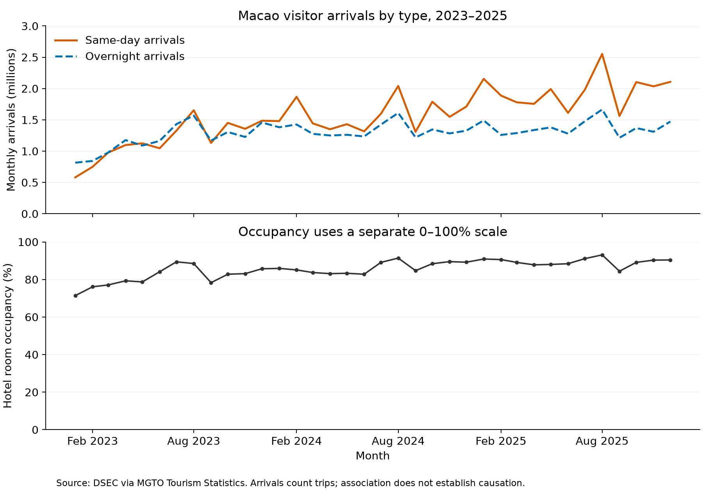

Data science · Clear evidence · Honest limits
<h1>Making patterns understandable.</h1>
I’m Guanyu Ke, an M.Sc. Data Science student at the University of Macau, studying Computational Linguistics. This portfolio documents my ongoing work in data analysis and visualization.

## Technical skills

Pythonpandas & NumPyMatplotlibJupyter NotebookData validationGit & GitHub

## Selected project

Ongoing · 2023–2025 monthly data

### Macao tourism: a changing visitor mix

**Research question:** Which visitor type supplied the increase in arrivals, and how did hotel occupancy change over the same 36 months?

**Main finding:** Same-day visitors accounted for approximately **90% of the increase in visitor arrivals from 2024 to 2025**.

Same-day and overnight arrivals use one scale; occupancy uses a separate aligned panel with a 0–100% scale. Source: DSEC via MGTO Tourism Statistics; author calculations.

Same-day visitors supplied approximately **90% of the increase from 2024 to 2025**. Their share of all arrivals rose from about 50% to 59% across 2023–2025. The simple mean of monthly hotel occupancy rates rose from about 81% to 89% over the same period.

Each stacked bar adds to the annual increase. The same-day contribution is printed beside each bar. Annual totals hide within-year variation.

<aside><strong>What these data cannot establish</strong> Co-movement does not prove that high occupancy caused more same-day visits. Arrivals count trips, and overnight visitors need not stay in hotels. Room supply, prices, market mix and earlier baseline years are absent.</aside>

**Next steps:** Add room supply, prices and visitor-market detail; inspect seasonality and improve the source-data retrieval workflow.

<a href="https://github.com/yujiangke/data-science-project">Explore code & methods ↗</a><a href="https://github.com/yujiangke/data-science-project/blob/main/macao_tourism_analysis.ipynb">Read the Notebook ↗</a><a href="https://dataplus.macaotourism.gov.mo/">Official data source ↗</a>

## How I approach analysis

I keep the research question, data definitions and transformations visible. I check joins and missing values before plotting, use charts that support meaningful comparisons, and separate observed patterns from causal explanations.

This page presents an ongoing course project. See the repository for source details, reproduction instructions and usage limitations.
